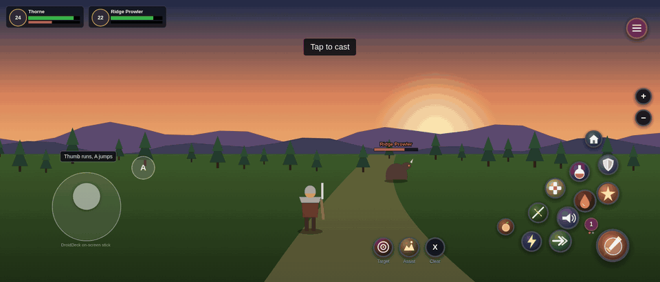
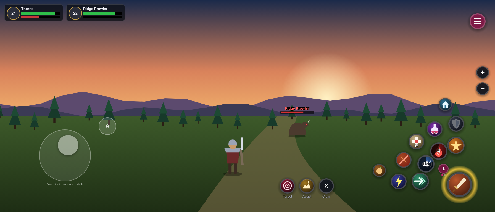
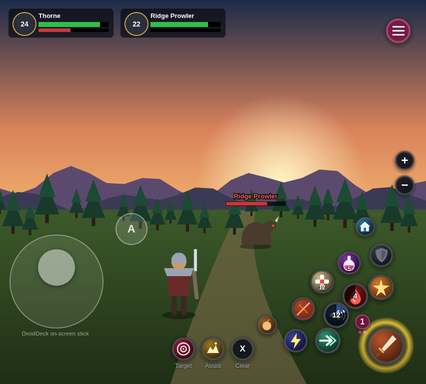
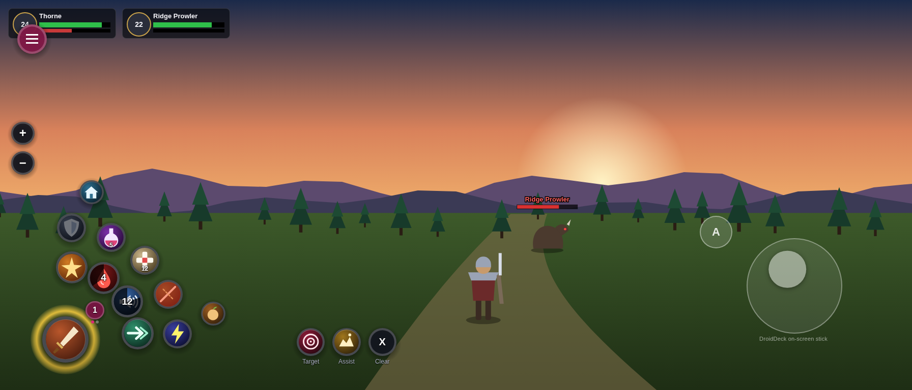
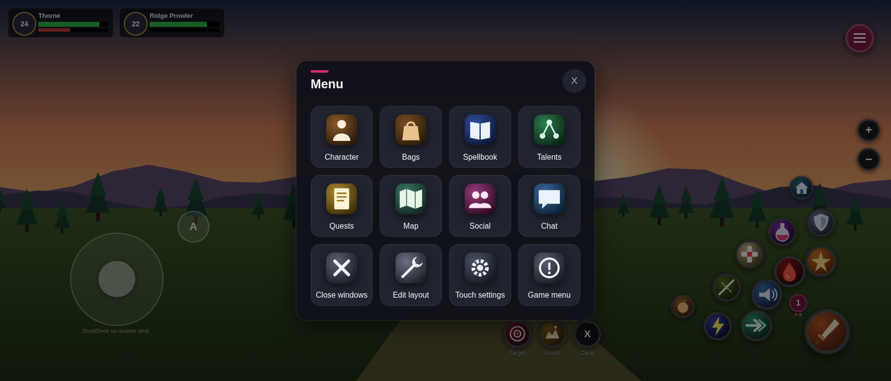
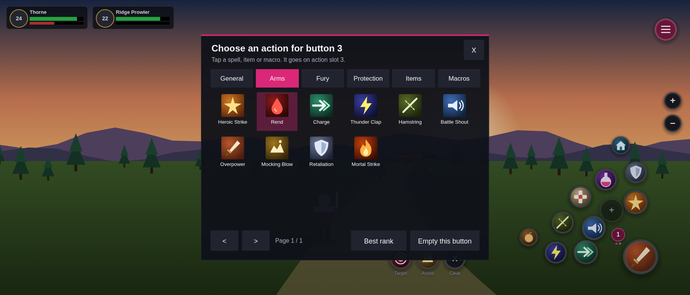
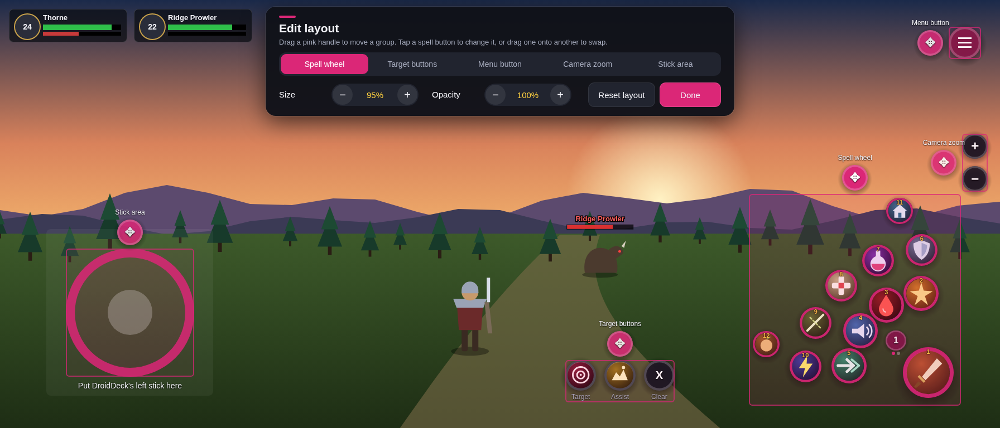
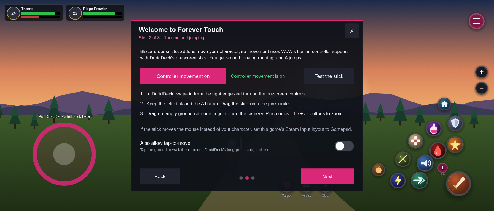

<p align="center">
  
</p>

<h1 align="center">Forever Touch</h1>

<p align="center">
  <b>Touch screen controls for World of Warcraft: Forever.</b><br>
  A thumb-sized spell wheel, one-tap menus and a guided setup for phones and foldables.<br>
  Built for playing through <a href="https://www.techspot.com/downloads/7924-droiddeck.html">DroidDeck</a> on a Galaxy Z Fold 8.
</p>

<p align="center">
  
</p>

> **About the images.** These are rendered UI previews, not in-game captures. The position and size of every button comes from the addon's real Lua code, run through the mock WoW client in `tests/` (see [How the previews are made](#how-the-previews-are-made)). The game world, character and unit frames are stand-in drawings, and the icons are original placeholders, not Blizzard art. Screenshots and recordings from real devices are very welcome. Please open a PR!

---

## Contents

- [Features](#features)
- [Screenshots](#screenshots)
- [How movement works](#how-movement-works-running-and-jumping)
- [Install](#install)
- [Setting up DroidDeck](#setting-up-droiddeck)
- [Using it](#using-it)
- [Settings and commands](#settings-and-commands)
- [Limits worth knowing](#limits-worth-knowing)
- [Troubleshooting](#troubleshooting)
- [Development](#development)
- [Contributing](#contributing)
- [License](#license)

## Features

| | |
|---|---|
| **Spell wheel** | 12 buttons: one big thumb button, an inner arc of 4, an outer arc of 5 and 2 minis. Together they hold exactly one action bar. |
| **Live button state** | Round cooldown sweeps with seconds, red tint when out of range, blue when out of mana or rage, stack counts, a gold glow for auto-attack and a pink glow for procs. |
| **Pages** | Page 1 follows your main bar, so warrior stances, druid forms and rogue stealth swap automatically. Pages 2 and 3 show any other action bar. Tap the little number on the wheel to flip pages. It works in combat. |
| **Tap to assign** | Tap an empty **+** button and choose a spell, usable item or macro from a big grid. Classic's rank lists show only the best rank by default. |
| **One-tap menu** | Character, Bags, Spellbook, Talents, Quests, Map, Social, Chat, Close windows, Edit layout, Touch settings and Game menu. It works in combat, and tapping outside closes it. |
| **Target row** | Target nearest enemy, Assist, Clear target, plus Pet attack for hunters and warlocks. |
| **Camera** | Drag on empty ground to turn the camera. The + / − buttons zoom, and holding one keeps zooming. |
| **Edit layout** | Drag the pink handles to move groups and resize them from 50 to 170%. Set opacity, tap a button to reassign it, or drag one button onto another to swap. |
| **Fold aware** | The folded (cover) and unfolded (inner) screens each keep their own layout and switch automatically when you open or close the phone. |
| **Left-handed mode** | Mirrors the whole layout. |
| **Guided setup** | A 3-step guide on first login covers your thumbs, movement and comfort settings. |
| **Combat safe** | Built on Blizzard's secure templates. Anything that can't change in combat waits until the fight ends instead of erroring. |

## Screenshots

### Folded: cover screen
The default layout: spell wheel under the right thumb, DroidDeck's stick under the left, and the target row in between.



### Unfolded: inner screen
The nearly square inner screen gets its own layout, which switches automatically when you unfold.

<p align="center"></p>

### Left-handed
One toggle mirrors everything.



### Menu
Every game window is one tap away, even in combat.



### Tap to assign
Tap an empty button and pick from your spellbook, usable items or macros.



### Edit layout
Pink handles move groups, the toolbar resizes them, and the pink circle shows where DroidDeck's stick fits.



### Guided setup
Step 2 switches on controller movement and walks you through the DroidDeck side.



## How movement works (running and jumping)

**Blizzard does not allow any addon to move or jump your character.** The protection exists to stop bots and applies to every addon, so an addon can't draw a working joystick. Forever Touch uses the path Blizzard does allow, which is WoW's own controller support:

1. The setup guide turns on WoW's controller support (`GamePadEnable`) and binds **A = Jump**.
2. DroidDeck's on-screen stick shows up to the game as a controller, so the left stick gives smooth **analog running**: half-push to walk, full push to run.
3. Your other thumb stays on the spell wheel, so you can run and cast at the same time.

Two optional extras:

- **Tap-to-move:** WoW's click-to-move, toggled in setup step 2. It walks to wherever you tap and needs DroidDeck's long-press mapped to right click.
- **Screen keys:** if your DroidDeck build has on-screen keyboard keys, `W A S D` and `Space` work as usual.

## Install

1. **Download** the latest zip from [Releases](../../releases), or build one yourself (see [Development](#development)).
2. **Copy** the `ForeverTouch` folder into the game's AddOns folder:
   ```
   World of Warcraft/<forever game folder>/Interface/AddOns/ForeverTouch/
   ```
   Under DroidDeck, the `World of Warcraft` folder is on the Windows drive of the Proton prefix where you installed Battle.net.
3. On the character select screen, open **AddOns** and make sure **Forever Touch** is ticked.
4. **Log in.** The setup guide opens after about two seconds.

### "Out of date" warning
The TOC declares `## Interface: 16001, 16000, 11508`, which is a best guess for WoW: Forever 1.60.x. If the addon list says it's out of date, tick **Load out of date AddOns**, or set the exact number:

```sh
# in game:   /dump (select(4, GetBuildInfo()))
tools/set-interface.sh 16001   # use the number the game printed
```

## Setting up DroidDeck

DroidDeck is evolving quickly, so menu names may differ slightly in your version.

1. **On-screen controls:** during play, swipe in from the right edge to open the session drawer and turn on the on-screen controls.
2. **Keep it minimal:** keep the **left stick** and the **A** button and hide the rest. Forever Touch handles everything else.
3. **Place the stick** on the pink circle that appears during setup step 2 and in Edit layout.
4. **Gestures:** keep **tap → left click**. Optionally map **long-press → right click** (for tap-to-move) and **pinch → mouse wheel** (zoom).
5. **Steam Input:** if the stick moves the mouse pointer instead of your character, set this game's controller layout to **Gamepad**.

## Using it

| To… | Do this |
|---|---|
| Cast a spell | Tap its button. With *Cast the moment you touch* on, it fires on touch-down. |
| Put a spell on an empty button | Tap the **+**, then tap a spell, item or macro. |
| Change a button that has a spell | Open the **menu → Edit layout**, then tap the button. |
| Swap two buttons | In Edit layout, drag one button onto the other. |
| Flip spell pages | Tap the small number next to the big button. |
| Target the nearest enemy | Tap **Target**. |
| Talk, loot or open things | Tap them in the world (needs *Tap to interact*). |
| Turn the camera | Drag one finger across empty ground. |
| Zoom | Pinch, or use **+ / −** (hold to keep zooming). |
| Move things around | Menu → **Edit layout**, then drag the pink handles. |
| Chat | Menu → **Chat**, then open DroidDeck's keyboard. |

## Settings and commands

Open the settings from the menu tile **Touch settings**, with `/ft`, or under **Options → AddOns → Forever Touch**.

- **Screen layout:** Auto, Folded or Unfolded.
- **Spell thumb:** Right or Left.
- **Spell wheel pages:** 1 to 3. Page 1 is always the main bar. Pages 2 and 3 can be the bottom left, bottom right, right, right 2 or action bar 2.
- **Controls:** show or hide the target buttons, the camera buttons and empty slots. *Dim out of combat* and *Hide default action bars* are here too. Hiding the bars keeps the XP and pet bars, and showing them again needs `/reload`.
- **Controller movement** and **Tap to interact**, when your client supports them.

The setup guide also offers *Auto loot*, *Cast the moment you touch* and *Cooldown numbers*. Each one only appears if your client has the setting.

| Command | What it does |
|---|---|
| `/ft` | Open settings |
| `/ft edit` | Edit layout: move, resize and assign buttons |
| `/ft setup` | Run the setup guide again |
| `/ft reset` | Reset the current screen's layout |
| `/ft touchtest` | Check where your taps land (shows the game's cursor and your taps) |
| `/ft padtest` | Check the movement stick: does WoW see a controller, and does the stick move? |
| `/ft touchfix` / `/ft touchfix off` | Re-apply or undo the touch input settings |
| `/ft help` | List commands |

## Limits worth knowing

- **No addon can move your character.** Movement runs through WoW's controller support, as described [above](#how-movement-works-running-and-jumping).
- **Changes are locked during combat.** Blizzard locks secure buttons in combat. Casting, page flips and the menu all still work, but assigning or moving buttons doesn't. Edit mode closes by itself when a fight starts.
- **Multi-touch.** DroidDeck handles its stick separately, so running while casting works. Two taps on WoW buttons at the very same moment arrive as one mouse, though.
- **Auto fold switching** reads the game's screen size. If DroidDeck runs the game at a fixed resolution, choose *Folded* or *Unfolded* in settings yourself.
- **Early real-device testing.** First reports from a Galaxy Z Fold 8 found the touch and stick issues covered in [Troubleshooting](#troubleshooting). More testers with WoW: Forever on Android are wanted.

## Troubleshooting

### Touching shows the cursor but nothing gets pressed
Taps are clicking wherever the cursor already was, not where your finger is. Type `/ft touchtest` (open DroidDeck's keyboard) to confirm: gold dots show where the game felt each tap.

1. **DroidDeck → Touch mode → Direct** (not Touchpad).
2. **Update DroidDeck.** Preview builds from before Nov 5 2026 send every touch through the touchpad while a game holds the pointer, even in Direct mode. This was fixed in [DroidDeck #2133](https://github.com/Droid-Deck/DroidDeck/pull/2133). Stable 0.6.9 doesn't have this problem.
3. Forever Touch 1.0.1+ also changes three game settings once at login: raw mouse input off, cursor not locked to the window, and hardware cursor on. Together these make the cursor jump to your finger. Restart the game once afterwards. Undo with `/ft touchfix off`.

### The left stick doesn't move my character
Addons can't move characters, so the stick has to reach WoW **as a controller**. Type `/ft padtest` (or use **Test the stick** in setup step 2). It shows whether WoW sees a controller and draws your stick live:

| Test result | What to do |
|---|---|
| *Controller support is off* | Tap **Turn it on**, then restart the game once. |
| *WoW doesn't see any controller* | Restart the game once. Make sure DroidDeck's **on-screen controller** is on (not just touch). In Steam, set this game's controller layout to **Gamepad**. |
| *Sees a controller, but the stick isn't moving it* | DroidDeck's stick is feeding a different device. Set Steam Input to **Gamepad**, or use the key fallback below. |
| *WoW receives your left stick* but you still don't move | Close any open game windows (bags, map…). While one is open, the stick can drive the controller cursor instead. |

**Key fallback (always works):** in Steam, set this game's controller layout to **Keyboard (WASD) and Mouse** and map A to Space. The stick then presses W A S D like a keyboard, with no WoW controller support needed. Turn *Controller movement* off in `/ft` settings if you use this.

### Everything else

| Problem | Fix |
|---|---|
| The addon isn't in the AddOns list | Check the folder name. It must be exactly `Interface/AddOns/ForeverTouch/ForeverTouch.toc`, not nested twice. |
| "Out of date" | Tick *Load out of date AddOns*, or run `tools/set-interface.sh` ([details](#out-of-date-warning)). |
| The stick moves the mouse pointer | Set the Steam Input layout for the game to **Gamepad** (or the key fallback above). |
| A doesn't jump | Run `/ft setup`, go to step 2 and tap *Turn on controller movement* again. |
| Taps cast twice or not at all | Toggle *Cast the moment you touch* in `/ft setup` step 3. |
| Buttons are off screen after unfolding | `/ft reset` resets that screen's layout. |
| "Can't be changed during combat" | Wait for combat to end. This is Blizzard's rule. |

## Development

Requirements: **Lua 5.1** (the version WoW uses) and **Python 3**. Making the README previews also needs **Google Chrome** and **ffmpeg**.

```sh
sh tests/run_all.sh                 # syntax check, mock-client suite in 3 click modes, on-screen layout check
python3 tools/build.py              # package dist/ForeverTouch-<version>.zip
python3 tools/make_textures.py      # regenerate ForeverTouch/media/*.tga
sh tools/preview/capture.sh         # regenerate docs/images/* (screenshots + demo.gif)
```

### The mock WoW client
`tests/mock_wow.lua` is a small fake WoW client. It models frames, scripts and attributes, Blizzard's restricted snippet environment (state drivers, `ChildUpdate`, frame refs, wrapped clicks) and, most importantly, **combat lockdown**. Any insecure change to a protected frame during combat fails the run with `ADDON_ACTION_BLOCKED`, the same class of bug that breaks addons in the real game. `tests/run.lua` covers:

- casting, page flips in combat and stance paging
- the spell picker: rank dedupe, items, macros, assigning and clearing
- the menu in combat: secure micro button clicks, closing after a tile, tapping outside
- edit mode: dragging, resizing, swapping buttons, and closing automatically on combat
- left-handed mirroring, fold/unfold switching, and layout changes deferred until after combat
- setup: controller movement and the A = Jump binding
- touch input fixes (apply/undo) and the touch test verdicts
- the controller test: no controller, stick not moving, stick working, support off

The suite runs in all three click modes: cast on press, cast on release, and legacy clients.

### How the previews are made
`tools/preview/export_layout.lua` loads the real addon in the mock client, logs in, and exports the on-screen rectangle of every control for the folded, unfolded, left-handed and edit-mode layouts. The export **fails if any control would be off screen**. `tools/preview/preview.html` draws those rectangles over a stand-in scene, and `capture.sh` screenshots it with headless Chrome and builds the GIF with ffmpeg.

### Project layout

| File | Purpose |
|---|---|
| `ForeverTouch/Core.lua` | Saved settings, event plumbing, combat-safe queue, Fold screen profiles |
| `ForeverTouch/Widgets.lua` | Round buttons with press/ripple feedback, panels, toggles, steppers |
| `ForeverTouch/ActionCluster.lua` | Secure spell wheel, paging snippets, cooldown/range/proc visuals |
| `ForeverTouch/Utility.lua` | Target row and camera zoom |
| `ForeverTouch/Menu.lua` | Secure tile menu |
| `ForeverTouch/SpellPicker.lua` | Tap-to-assign grid for spells, items and macros |
| `ForeverTouch/EditMode.lua` | Move/resize/assign mode and the stick guide |
| `ForeverTouch/Setup.lua` | First-run guide, controller movement, recommended settings, hiding the default bars |
| `ForeverTouch/Settings.lua` | Settings panel, Blizzard options entry, slash commands |
| `tests/` | Mock client and test suite |
| `tools/` | Build, texture generation, interface number and preview tooling |

## Contributing

Issues and PRs are welcome, especially:

- **Real-device screenshots or recordings** (Galaxy Fold or any Android/DroidDeck setup) to replace the rendered previews
- the confirmed **Interface number** and any API differences in WoW: Forever
- DroidDeck setup notes for other devices

Please run `sh tests/run_all.sh` before opening a PR.

## License

[MIT](LICENSE) © 2026 Josh Hamilton.

World of Warcraft is a trademark of Blizzard Entertainment, Inc. This is an unofficial fan project and is not affiliated with or endorsed by Blizzard Entertainment or the DroidDeck project.
